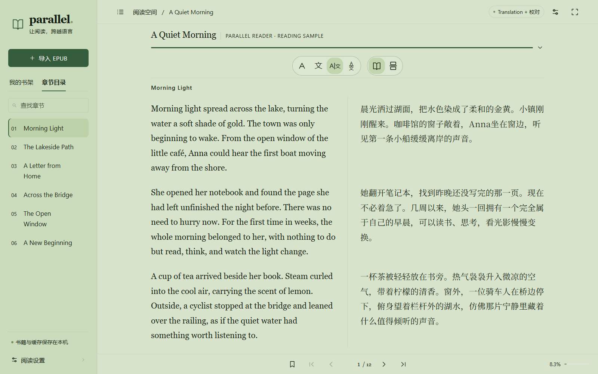

# Parallel Reader®

**Read across languages. Stay in the story.**  
**跨越语言，专注阅读。**

A portable bilingual EPUB reader with contextual translation, proofreading, and in-image translation.  
一款支持语境翻译、译文校对和图片内翻译的便携式双语 EPUB 阅读器。



## English

### Features

- Four reading layouts: original, Chinese translation, side-by-side, and alternating paragraphs.
- Paginated, continuous scrolling, and immersive reading with chapter navigation.
- Separate typography settings for each language and multiple reading themes.
- Context-aware translation using book metadata, surrounding passages, and available glossaries.
- Separate translation, proofreading, and optional word-lookup models, configured by the user.
- Choose LLM or Azure Translate for book translation; choose the word/context translation service independently.
- Whole-book processing with progress, pause/resume, retries, and repeated proofreading passes.
- Up to four text chapters and two images concurrently per book.
- In-image translation with original/translated image switching and QR-code preservation.
- Sentence correspondence highlighting and contextual word lookup without reading ahead.
- Bookshelf cover views, reading/translation progress, one bookmark per book, and return-to-bookmark.
- Local translation caching and Chinese-only or bilingual EPUB export, including translated illustrations.

### Program and private library are separate

The public repository and program release contain **no books, saved translations, private model endpoints, or API keys**. Model endpoint and model-name defaults are empty.

All private library resources live in `.data/`: original EPUB files, the library database, translations, translated images, exported EPUBs, bookmarks, reading positions, and local model configuration. This directory is ignored by Git and excluded from public builds.

To use your library on another computer:

1. Close the reader before copying, or create a consistent snapshot with the export tool below.
2. Copy `.data/` into the new program's root folder.
3. Start the program. The bookshelf, saved translations, reading positions, and bookmarks will be available.

For a compact private transfer folder that excludes old backups and logs, removes API keys, and pauses unfinished tasks:

```powershell
python tools/export_library.py --output private-transfer/.data
```

The transfer folder is private data. Keep it separate from public program releases. Local model configuration remains in the library; check it before sharing.

### Getting started

On Windows 10/11 x64, download this repository using **Code → Download ZIP**, then extract the entire folder and run `start.bat`. The `main` branch includes the portable Python runtime, Pillow and Chinese fonts, so no Python or pip installation is required. Keep the startup window open while reading. Do not run the launcher from inside the ZIP.

The Windows portable release works the same way. Use `start-mobile.bat` for access from a phone on the same local network. If startup fails, run `check-portable.bat` to check the runtime, imports, fonts and any existing library. Release packages also verify their file checksums.

For development with your own Python 3.10+ installation instead of the bundled runtime:

```powershell
python -m pip install -r requirements.txt
python server.py --open
```

Import an unencrypted EPUB and select LLM or Azure Translate in Settings. LLM book translation uses the book model configuration. LLM word/context explanations require their own endpoint and model; changing the book service does not change the lookup service.

Click **＋** in the bookshelf to select an EPUB from your file system. Importing copies the original file into `.data/sources/`; the reader does not depend on the file remaining in its previous location. Copy the entire `.data/` folder when moving your library to another computer.

Saved content can be read offline. New translations require the selected service; proofreading requires an LLM. Word lookup defaults to Azure Translate and can independently use an LLM for fuller explanations. Model weights are not included. Content needed for a request is sent to the selected service.

### Saved translations and service switching

Translations remain stored separately by service/configuration. Changing the translation service does not delete existing versions. If the new configuration has no saved text for the current book but another local version exists, the reader asks whether to keep reading that saved version or translate with the new service. If no local version exists, translation starts normally. The **Local translation** button shows the saved version's source and paragraph count and lets you change it later; choices are remembered per book and configuration.

When reading a saved version, cached paragraphs and their sentence correspondence are reused without translation requests. Missing paragraphs use the current service and stay in that service's own cache. EPUB export uses the selected reading version, including those filled gaps. Whole-book background processing and proofreading retain their own configuration-specific progress.

A single word/context service setting controls both basic meanings and contextual explanations, independently of the book service. Azure Translate provides dictionary meanings, English parts of speech and a contextual translation using the current sentence and up to ten preceding sentences. Oversized context is shortened to the service's request limit. Dictionary parts of speech describe common uses; the contextual result is a machine translation, with the whole translated sentence shown if word markup is unavailable. Choose **LLM** in the word/context service setting for richer explanations, using a separately configured lookup model. The popup identifies the provider in one small line.

### Translation services

Select **LLM** or **Azure Translate** under **Book translation**. LLM supports contextual translation, proofreading and image translation. Azure Translate handles text; images remain original and are excluded from its translation progress. Both support saved paragraph translations, sentence correspondence, whole-book processing, pause/resume and EPUB export.

Select **LLM** or **Azure Translate** separately under **Word / context translation**. This choice controls both fields in the lookup popup and does not follow the book service. LLM lookup uses its own endpoint, model and optional key.

### Keeping the private library compact

The library directory contains original EPUBs in `sources/`, translated illustrations in `translated-images/`, exported EPUBs in `exports/`, and `reader.sqlite3` for settings, saved translations, sentence alignment, dictionary caches, reading positions, bookmarks and resumable jobs. `library-catalog.json` retains import information. SQLite may also create temporary `-wal` and `-shm` files while running.

Builds and test output belong in `dist/` and `test-results/`, outside `.data/`. To inspect generated files that can be removed, then clean them with the reader closed:

```powershell
python tools/clean_library.py
python tools/clean_library.py --apply --prune-history
```

Cleanup keeps originals, current saved translation versions, referenced illustrations and reading/job state. It removes unreferenced translated images, older export files and, with `--prune-history`, previous proofreading snapshots. Current LLM/Azure translation versions remain available. It verifies the database contents before and after compaction; it does not change future history retention.

### Public builds and checks

```powershell
python tools/audit_public.py
python tools/build_release.py --zip
python -m unittest discover -s tests
```

Public builds always use an empty library. They include application sources, permitted fonts, runtime dependencies, documentation, and synthetic tests. Private book resources and model configuration are not bundled.

This beta supports unencrypted EPUBs. Complex layouts, small or rotated image text, and model-generated translations may require comparison with the original.

## 中文

### 功能特性

- 原文、中文、双列对照和段落跟随四种阅读布局。
- 翻页、连续滚动和沉浸阅读，支持章节导航。
- 中英文字体、字号和粗细独立调整，多种阅读主题。
- 结合书籍信息、上下文和可用术语表进行翻译。
- 初译、校对和可选的独立查词模型由使用者自行配置。
- 图书翻译提供 LLM 和 Azure Translate；单词／语境翻译独立选择服务。
- 全书后台处理，支持进度显示、暂停、继续、失败重试和多轮校对。
- 每本书最多同时处理四个文本章节和两张图片。
- 译文直接排入图片，可切换原图／译图，并保留二维码。
- 中英文句子对应高亮，双击单词查看不读取后文的语境解释。
- 封面书架、阅读／翻译进度、每书一个书签，从书架打开时返回书签。
- 译文缓存保存在本机，可导出包含译图的中文或双语 EPUB。

### 程序与私人书库分离

公开代码和程序发布包**不包含原书、已保存译文、私有模型地址或 API Key**。模型地址和模型名称的默认值均为空。

所有私人书库资源统一保存在 `.data/`：原始 EPUB、书库数据库、译文、译图、导出 EPUB、书签、阅读进度和本地模型配置。该目录已被 Git 忽略，并从公开构建中排除。

在另一台电脑使用已有书库：

1. 先关闭阅读器再复制；也可使用下方工具生成一致性快照。
2. 把 `.data/` 放到新程序的根目录。
3. 启动程序，即可读取书架、已保存译文、阅读位置和书签。

如果需要不带旧备份和日志的私人迁移副本，可运行：

```powershell
python tools/export_library.py --output private-transfer/.data
```

该工具保留书库资源，清空副本中的 API Key，并暂停未完成任务。迁移副本仍属于私人数据，不应混入公开发布包；分享前请检查其中的本地模型配置。

### 开始使用

Windows 10/11 64 位电脑可直接在仓库点击 **Code → Download ZIP**，完整解压后双击 `start.bat`。`main` 分支包含便携 Python、Pillow 和中文字体，无需安装 Python 或 pip。阅读时保持启动窗口打开，不要在压缩包内直接运行。

Windows 便携发布包使用方法相同；手机同局域网访问使用 `start-mobile.bat`。启动失败时运行 `check-portable.bat`，检查运行环境、程序导入、字体及已有书库；正式构建的发布包还会校验文件完整性。

开发时如需使用自己安装的 Python 3.10+，可运行：

```powershell
python -m pip install -r requirements.txt
python server.py --open
```

导入未加密 EPUB 后，在设置中选择 LLM 或 Azure Translate。图书 LLM 与查词 LLM 分别配置接口和模型，改变图书服务不会改变查词服务。

点击书架中的 **＋**，从文件系统选择 EPUB。导入时原文件会复制到 `.data/sources/`，之后不依赖原来的文件位置；迁移时带上整个 `.data/` 文件夹即可。

已有译文可离线阅读；新增翻译需要连接所选服务，正文校对需要大模型。单词翻译默认使用 Azure Translate，也可独立选择 LLM。程序不包含模型权重，处理所需内容会发送到所选服务。

### 已有译文与服务切换

不同服务／配置的译文仍分开保存，切换服务不会删除已有版本。如果新配置还没有当前书籍的译文，但本地已有其他版本，阅读器会询问是继续阅读已有译文，还是使用新服务翻译；没有任何本地译文时则正常开始翻译。**本地译文**按钮会显示来源和已保存段落数量，可随时切换，选择按书籍和配置记住。

阅读已有版本时，已保存段落和句子对应直接复用，不发送翻译请求。缺失段落由当前服务补齐，并保存在当前服务自己的缓存中。EPUB 导出使用所选阅读版本及已补齐的段落；整书后台处理和校对仍单独显示当前配置的任务进度。

单词翻译独立于正文服务和所选译本。Azure Translate 从词典获取基本义及英文词性缩写，并仅结合当前句及之前最多十句翻译选中单词；上下文过长时会按服务请求上限缩短。词性展示词典常见用法，语境结果属于机器翻译；单词标记丢失时会明确显示为所在句译文。需要更充分的辨义解释时，可在单词／语境翻译设置中选择 **LLM**。

### 翻译服务

**图书翻译**提供 **LLM** 和 **Azure Translate**。LLM 支持语境翻译、校对及图片翻译；Azure Translate 处理文字，图片保留原图，不计入其翻译进度。两者均支持段落保存、句子对应、整书处理、暂停／继续和 EPUB 导出。

**单词／语境翻译**单独选择 **LLM** 或 **Azure Translate**，一个选项同时控制基本义和语境结果，不随图书服务变化。查词 LLM 使用独立的接口、模型和可选 Key。悬浮框用一行小字显示“由 LLM 提供”或“由 Azure Translate 提供”。

### 保持私人书库精简

`.data/` 中的 `sources/` 保存原始 EPUB，`translated-images/` 保存译图，`exports/` 保存导出 EPUB；`reader.sqlite3` 保存配置、已有译文、句子对应、词典缓存、阅读位置、书签和续传任务，`library-catalog.json` 保存导入信息。运行时出现的 `-wal`、`-shm` 是 SQLite 的临时文件。

发布包和测试产物放在 `.data/` 外的 `dist/`、`test-results/`。关闭阅读器后，可先检查、再清理无用生成文件：

```powershell
python tools/clean_library.py
python tools/clean_library.py --apply --prune-history
```

清理保留原书、当前各版本译文、正在引用的译图、阅读和任务状态；删除未引用译图、较旧导出文件，添加 `--prune-history` 时同时删除旧校对快照。LLM／Azure 的当前已保存译本保留可读。工具会逐表校验整理前后的数据库，再压缩空间；不会改变未来的历史保留规则。

### 公开构建与检查

```powershell
python tools/audit_public.py
python tools/build_release.py --zip
python -m unittest discover -s tests
```

公开构建始终使用空书架，仅包含程序源码、许可允许分发的字体、运行依赖、文档和人工构造的测试。私人图书资源和模型配置不会被打包。

当前为 Beta 版本，支持未加密 EPUB。复杂版式、细小或旋转文字，以及模型生成的译文可能需要对照原文检查。

## Directory layout / 目录结构

```text
ParallelReader/
├─ server.py
├─ reader/                 # Application logic / 程序逻辑
├─ public/                 # UI and licensed fonts / 界面与授权字体
├─ docs/                   # Public documentation and demo screenshot / 公开文档与示例截图
├─ tests/                  # Synthetic tests / 人工构造的测试
├─ tools/                  # Public build and private transfer tools / 构建与迁移工具
├─ runtime/                # Portable Python, Pillow and licenses / 便携运行环境与许可
├─ start.bat
├─ start-mobile.bat
├─ check-portable.bat
└─ .data/                  # PRIVATE, Git-ignored, never publicly bundled / 私人书库
   ├─ reader.sqlite3
   ├─ sources/
   ├─ translated-images/
   └─ exports/
```

Third-party font and runtime licenses are included with their respective resources.  
第三方字体和运行时的许可随相应资源提供。
