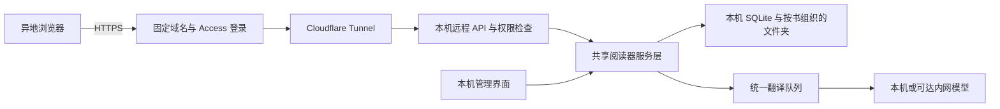

# Parallel Reader 异地访问设计

当前需求已收敛为“自己的 iPhone 异地使用”。已实现的个人启动方式见 [Tailscale 使用说明](tailscale.md)。下文保留为将来多人使用的扩展设计，不是当前个人使用的配置流程。

设计日期：2026-10-29。本文是改造方案，所列认证、多用户隔离和远程传输能力尚未实现。

## 目标与建议

让受邀用户在不同 Wi-Fi、手机流量或其他网络下，通过浏览器使用阅读器。你的电脑继续保存原书、译文和任务，并负责调用本机或可达内网中的模型。

正式入口建议使用“固定域名 + Cloudflare Access + Cloudflare Tunnel”。如果主要是自己异地访问，或少数愿意安装客户端的熟人，可以先使用 Tailscale Serve。两种入口应复用同一套应用权限和多用户数据模型。

默认按邀请制设计：管理员选择共享哪些书，用户各自保存阅读位置和书签。后续可开放个人书架、个人导入和受配额约束的翻译。

## 网络入口比较

| 方案 | 访客需要什么 | 主机需要什么 | 适用场景 |
| --- | --- | --- | --- |
| Tailscale Serve | 安装并登录 Tailscale，接受邀请 | Tailscale、在线的电脑 | 自己异地访问、少数熟人 |
| Cloudflare Tunnel + Access | 浏览器、受邀登录身份 | Cloudflare 账号、固定域名、cloudflared | 希望发链接即可使用的受邀用户 |
| 自有 VPS + 加密隧道 + HTTPS 反向代理 | 浏览器、应用登录 | VPS、域名、隧道与代理运维 | 需要自行管理公网入口或调整线路 |

Cloudflare Tunnel 通过主机向外建立连接发布应用，不要求主机有公网 IP 或路由器端口映射；Access 负责入口登录和准入策略。[官方 Tunnel 说明](https://developers.cloudflare.com/tunnel/)、[发布前配置 Access](https://developers.cloudflare.com/cloudflare-one/access-controls/applications/http-apps/self-hosted-public-app/)。

Tailscale Serve 提供私有网络内的 HTTPS 服务；受邀用户需要运行 Tailscale 客户端。设备共享可撤销，并用访问规则限制可访问服务。[Serve](https://tailscale.com/docs/features/tailscale-serve)、[设备共享](https://tailscale.com/kb/1084/sharing)。

通过 Cloudflare 入口的网页请求和文件会经过其代理，书库的长期存储位置仍在本机。如果更看重设备之间的端到端加密，可以选 Tailscale：直连和中继连接都使用 WireGuard 加密。[Tailscale 连接类型](https://tailscale.com/docs/reference/connection-types)。

## 推荐架构

网络请求由访客浏览器发到阅读器，再由阅读器调用模型。浏览器不直接访问模型接口。模型地址中的 `127.0.0.1` 指服务器这台电脑；内网模型地址也只需要服务器能够访问。

对外只发布阅读器远程入口。模型接口、总数据库、磁盘目录及本机管理员入口不作为隧道公开路由。

建议保留现有本机入口 `127.0.0.1:8765`，新增受认证的远程入口，例如 `127.0.0.1:8766`。两者在同一进程中共享 Store、缓存和任务调度服务，不各自启动一套后台任务。隧道只指向远程入口。

## 当前代码需要解决的问题

| 当前情况 | 改造要求 |
| --- | --- |
| Host 仅允许已配置的本机或局域网地址，Origin 按 HTTP 比较 | 增加明确的外部 HTTPS Origin 配置；仅信任已配置代理，保留同源检查 |
| 没有应用用户身份、角色和书籍访问权限 | 每个 API 验证身份与资源权限，包括图片、导出、归档状态和下载 |
| 阅读进度存在 books.page，书签按 book 唯一 | 增加按 user_id + book_id 保存的阅读状态 |
| 模型设置为全局设置，任一可调用接口的访问者都能修改 | 服务配置仅管理员可改；普通用户仅看到必要的服务状态 |
| Translator.window 会清空全局前台队列 | 按阅读会话保存窗口，合并所有活跃窗口的需求 |
| 归档表示整个本机书架，任务与文件没有用户归属 | 导入、导出、临时上传和下载均绑定用户与书籍权限 |
| 一个归档分卷作为一次上传请求 | 实现可恢复的文件分块上传 |
| 首次打开书籍返回全部正文 | 增加按页获取正文，降低大书在远程网络的首次加载量 |
| 当前 HTTP 服务用于本机应用 | 将远程 API 接入适合部署的应用服务器，配置请求大小、连接数和超时 |

这里的网络入口和应用权限是两个独立层次。能通过 Access 登录不代表可以访问所有书，也不代表可以修改模型设置。

Python 官方将当前使用的 http.server 定位为只有基础安全检查的服务器，不建议作为生产服务。正式多人入口应迁移 HTTP 接入层，现有书籍解析、翻译、归档逻辑可以继续复用。[Python 官方说明](https://docs.python.org/3/library/http.server.html)。

## 身份与权限

入口采用受邀身份，不开放自行注册。Cloudflare Access 可接现有身份提供方；应用把经过验证的身份映射为本机 user_id。应用仍保存启用状态、角色、配额和共享规则。

应用验证身份令牌的签名、签发者、应用受众和有效期，不把一个邮箱请求头当成登录凭据。可同时启用 cloudflared 的 Protect with Access。停用用户时，应用立即拒绝其后续请求。[Access 令牌与校验](https://developers.cloudflare.com/cloudflare-one/access-controls/applications/http-apps/authorization-cookie/application-token/)、[源站保护](https://developers.cloudflare.com/cloudflare-one/access-controls/applications/http-apps/self-hosted-public-app/)。

| 身份 | 默认权限 |
| --- | --- |
| 管理员 | 管理成员、模型、共享书籍、主机任务和整库归档 |
| 阅读用户 | 阅读明确共享的书，保存自己的书签、进度和显示偏好 |
| 个人书架用户（后续开放） | 额外允许导入个人书籍、在配额内翻译、打包自己的书架 |

共享权限分别控制阅读、下载和触发新翻译。共享给用户阅读，不自动赋予整库打包、批量翻译或转共享权限。

会话使用 HttpOnly、Secure、SameSite Cookie；变更操作验证 CSRF 与 Origin。身份、会话和归档任务令牌不放在 URL 中。所有书籍对象必须在后端检查权限，隐藏界面按钮不能代替检查。

远程用户不能设置任意模型 URL。管理员的模型配置只在服务端使用，普通用户无法读取密钥或借接口请求其他内网服务。

## 书库与进度隔离

保留当前 `.data/books/书名 -- 短编号/` 的物理组织方式。共享数据库增加以下逻辑关系：

- users：稳定用户编号、登录身份映射、角色、状态、配额。
- user_books：书籍所有者及书架归属。
- book_shares：谁可以阅读、下载和请求翻译。
- user_reading_state：按用户和书籍保存当前页、书签、所选译本与阅读偏好。
- user_jobs / upload_sessions / archive_jobs：任务所有者、状态、资源范围与过期时间。

原书和允许共享的译文可以复用；每个人的阅读状态独立。私人译本不会因为源文件相同就自动对其他用户可见。相同书名的不同版本继续保留。

已有书籍、进度和书签迁移给默认的本机管理员。默认不共享现有书架，管理员逐书授权。迁移先备份，兼容已有单书快照。

第一版继续使用位于本机磁盘上的 SQLite，并统一写入路径。是否需要换数据库，应根据真实并发和写入延迟决定；远程用户不直接访问数据库文件。

## 多人翻译调度

以 user_id + reading_session_id 保存每个阅读窗口。更新窗口只移除本会话的旧需求；调度器取所有会话的待处理并集。书籍、段落和翻译配置相同且权限允许时，同一请求只执行一次。

并发上限按整台主机和模型接口统一计算，避免每个用户各开四个章节耗尽模型资源。当前阅读和查词优先，整书翻译在后台排队；每位用户限制并行任务、待处理量和上传空间。已提交的长任务返回任务编号，客户端查询状态，断线后继续保存。

## 远程归档传输

保留当前用户选择的 **500 MiB 归档分卷**。另增加一层 **16 MiB HTTP 上传块**，浏览器自动处理，用户仍只选择原来的 ZIP 或全部分卷。

Cloudflare 当前列出的单次上传上限为 Free/Pro 100 MB、Business 200 MB；所以 500 MiB 分卷不能直接作为这些套餐下的一次上传请求。[官方上传限制](https://developers.cloudflare.com/cache/concepts/default-cache-behavior/)。

拟定协议：

1. 创建上传会话，提交文件名、大小和文件哈希，服务端检查用户权限与配额。
2. 分块上传，每块有序号、长度和 SHA-256；重传相同块应幂等。
3. 重新连接后查询已收到的块，只补传缺少的块。
4. 完成后校验完整文件哈希，再进入已有解密、校验和合并流程。
5. 临时文件到期自动清理。恢复只有在全部必要分卷校验通过后才提交。

这属于应用级分块，不是 HTTP Transfer-Encoding: chunked，不能只放开当前拒绝分块传输的检查。

密码仍由用户自行输入，只用于当次解密或加密。账户登录密码与归档密码相互独立。普通用户归档仅包含自己有打包权限的书及自己的阅读状态；主机整库打包为管理员专属功能。

下载增加 Range、ETag、Content-Length 与断点续传，每次下载和续传都复查身份和权限。私有 API、书页、译图和归档不启用公共 CDN 缓存。

## 管理界面与运行方式

本机增加“远程访问”设置：显示域名、入口健康、受邀用户、共享书籍、在线会话及翻译队列；提供停用用户和关闭远程入口。页面不向访客展示模型地址或主机文件路径。

Windows 上由服务或受控的启动器管理阅读器与隧道，支持重启后启动及失败重连。主机必须开机、有网络并保持模型可达。关机或睡眠期间不能提供访问；锁屏与停止服务是不同操作。主机上行带宽决定远程文件下载能力，多人下载会共同使用该带宽。

域名、Tunnel 和 Access 的具体套餐需按人数与使用量核对。线路选择应在实际访问地区和手机流量下验证。

## 分阶段实施与验收

第一阶段做“受邀共享阅读”：认证、逐书授权、独立进度与书签、多人前台队列隔离，以及远程 Host/Origin 适配。先在受控的私网环境验收，然后启用已认证的 HTTPS 入口。

第二阶段开放“个人导入与迁移”：个人书架、16 MiB 分块和断点续传、按用户归档、下载权限与任务配额。保留现有 500 MiB 分卷格式及本地使用体验。

第三阶段完善常驻运行与体验：Windows 启动管理、按页正文加载、队列监控、停用和回收机制。

必须通过的验收包括：

- 两个不同网络的用户同时读不同位置，互不覆盖书签或翻译队列。
- 未登录、已停用和越权请求不能获取正文、图片、归档或模型设置。
- 普通用户不能访问未授权书籍、修改全局模型或获取他人归档。
- 超过 500 MiB 的测试数据以多卷传输，断网后可续传，密码错误与缺卷不产生半套书架。
- 两个用户在同一共享译本上阅读时复用成功缓存，后台翻译不挤占全部交互资源。
- 服务重启后数据和任务保留；本机原有阅读、导入和归档回归通过。

推荐优先交付第一阶段。公网入口的连通只是其中一项，独立进度、资源权限和队列隔离决定多人能否真正同时使用。
